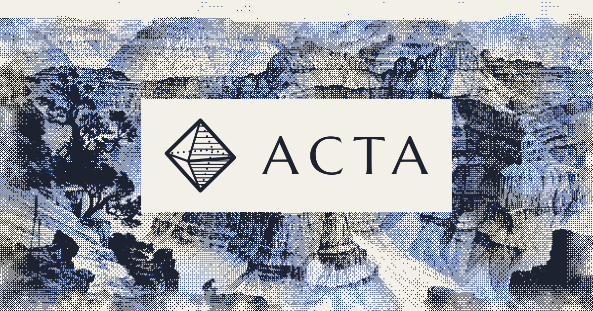

<p align="center">
  
</p>

<p align="center">
  <strong>Latin for “things done.”</strong><br />
  A calm project manager for small teams and the agents that work with them.
</p>

<p align="center">
  <a href="https://acta.aaenz.no">acta.aaenz.no</a> ·
  <a href="https://acta.aaenz.no/p/aaen-studios/acta">Issue tracker</a> ·
  <a href="https://acta.aaenz.no/docs">Docs</a> ·
  <a href="#agents">Agents and MCP</a> ·
  <a href="#running-it">Run it yourself</a>
</p>

---

## What it does

|  |  |
| --- | --- |
| **Board, table and timeline** | One set of tasks, three ways to see it. Drag cards between columns, edit cells in place, and plan on a timeline. |
| **Live** | Changes from teammates and agents appear as they happen, and you can see who else is on the board. |
| **Fast** | Boards you've opened stay in memory. Going back to one shows it at once and fetches only what changed. |
| **Workspaces** | Invite people as owners, admins, members or viewers, and fine-tune what each member may do. Each workspace has its own picture and holds as many boards as you like. |
| **Your own fields** | Give a board fields of its own (text, numbers, dates, single and multi selects), fill them in on each task, show them as table columns, and call its statuses what your team calls them. |
| **Settings that follow you** | Put your boards in your own order, and each board keeps your view, columns, sorting and saved filters on every device you sign in on, without waiting on the network. |
| **My tasks** | Everything assigned to you, from every board in the workspace, in one place. |
| **Public roadmaps** | Publish any board as a roadmap page. Visitors can vote and send ideas, and you choose which tasks show and how the page looks: its theme, colour, header, links, announcement and the order of its sections. |
| **Appearance** | Light, dark or your system's mode, an accent of your own, warmer or cooler surfaces, more contrast, larger text, line or pixel icons and less motion. |
| **GitHub** | Link repositories to boards. Branches, commits and pull requests that name a task show on it with their checks and review, move it along and mark it done on merge, and issues can sync both ways. |
| **Agents and API** | An MCP server lets Claude Code, Cursor and other agents read and work on your boards with keys you control, and an HTTP API lets scripts and other tools do the same. |

Built with Next.js 16 (App Router, Cache Components), React 19, Tailwind CSS 4 and Supabase (auth, Postgres,
realtime and storage).

## Agents

Acta has an MCP server at `/api/mcp`. Make a key under **Account → Agents** and add the server to your agent:

```bash
claude mcp add --transport http --scope user acta https://acta.aaenz.no/api/mcp \
  --header "Authorization: Bearer <key>"
```

Then put a line like this in your project's `AGENTS.md`, `CLAUDE.md` or README, so agents know which board to use:

```
Acta board: workspace/board
```

| Key | What it can do |
| --- | --- |
| **Read** | List boards, tasks, suggestions and activity, and search across every board it can reach |
| **Write** | Also create, change, sort, comment on, delete and restore tasks, one at a time or many at once |
| **Manage** | Also create boards, add, rename and recolour labels, projects and fields, rename statuses, run the public roadmap and triage ideas |

A key acts as the person who made it, and only in the workspaces they chose. The route checks the key, then
`agent_apply` and `agent_board` check it again in the database before running the app's own write path, so a key
never gets further than its owner. Everything an agent does is marked with the key's name, shown as
“Elliot via Claude Code”, and a key can only edit the comments it wrote.

Agents bringing work over from another tracker can keep its history: when each task was created and shipped,
and who wrote each comment and when. Work closed as not planned goes to **Canceled**.

## HTTP API

Anything that can send an HTTP request can use the same keys: scripts, forms, CI jobs, Zapier or n8n. The API serves
the MCP server's tools as plain JSON at `/api/v1/<tool>`, goes through the same checks, and a key can do exactly as
much as it can over MCP.

```bash
# What this key can do, with each tool's arguments as JSON Schema
curl https://acta.aaenz.no/api/v1 -H "Authorization: Bearer <key>"

# Read: GET with the arguments in the query string (lists repeat or use commas)
curl "https://acta.aaenz.no/api/v1/list_tasks?board=aaen-studios/acta&status=todo,review" \
  -H "Authorization: Bearer <key>"

# Write: POST the arguments as JSON
curl https://acta.aaenz.no/api/v1/create_tasks -H "Authorization: Bearer <key>" -H "Content-Type: application/json" \
  -d '{"board": "aaen-studios/acta", "tasks": [{"title": "Add CSV export", "labels": ["Feature"]}]}'
```

Answers are the tool's result as JSON. A mistake the caller can fix comes back as `400` with an `error` to read, a
missing or revoked key as `401`, and a tool the key's access doesn't cover as `403`. CORS is open, since every call
needs a key.

## Running it

```bash
bun install
cp .env.example .env.local
bun run dev
```

The app runs at http://localhost:3000. Without Supabase keys the marketing site, `/demo` and `/library` still
work, and the demo board saves to the browser.

### Environment

| Variable | What it does |
| --- | --- |
| `NEXT_PUBLIC_SUPABASE_URL` | Your Supabase project URL |
| `NEXT_PUBLIC_SUPABASE_PUBLISHABLE_KEY` | The project’s publishable (anon) key |
| `SUPABASE_SECRET_KEY` | Secret key, server only. Used for avatar uploads, account deletion and agent keys |
| `NEXT_PUBLIC_AUTH_PROVIDERS` | Comma-separated sign-in methods: `email`, `google`, `github` |
| `NEXT_PUBLIC_PUBLIC_ORIGIN` | Optional. The origin public roadmaps are served from, e.g. `https://acta.page` |
| `GITHUB_APP_ID` | Optional, with the five below. The GitHub App's id |
| `NEXT_PUBLIC_GITHUB_APP_SLUG` | The app's slug, from its public link `github.com/apps/<slug>` |
| `GITHUB_APP_PRIVATE_KEY` | The app's private key (PEM). Line breaks may be written as `
` |
| `GITHUB_APP_CLIENT_ID` | The app's client id |
| `GITHUB_APP_CLIENT_SECRET` | The app's client secret |
| `GITHUB_WEBHOOK_SECRET` | The app's webhook secret, which also signs install links |
| `GOOGLE_SITE_VERIFICATION` | Optional. The token Google Search Console gives for the HTML tag method |
| `BING_SITE_VERIFICATION` | Optional. The token Bing Webmaster Tools gives for its meta tag |

### Supabase

1. Apply everything in `supabase/migrations` in order (`supabase db push`, or paste each file into the SQL
   editor). They create the tables, row-level security, RPCs, the `avatars` storage bucket and the realtime
   publication.
2. Under **Authentication → URL configuration**, set the site URL to your origin and add `<your origin>/**` and
   `http://localhost:*/**` as redirect URLs.
3. Enable the OAuth providers you list in `NEXT_PUBLIC_AUTH_PROVIDERS`.
4. Under **Authentication → Emails**, set up custom SMTP. The built-in sender only mails your own team and allows
   a couple of emails an hour, so sign-in links won’t reach anyone else.
5. Admins come from `public.admin_emails`. Insert your address there. They see `/admin`: an overview of people, retention, work, agents, roadmaps and appearance choices (with a switch to leave the admins themselves out), and the site's traffic.

### Public roadmaps

Each board can publish a roadmap page at `/p/<workspace>/<board>`. Point a second domain at the app and set
`NEXT_PUBLIC_PUBLIC_ORIGIN` to it, and `src/proxy.ts` serves `<that domain>/<workspace>/<board>` from there.
A board's **new tasks are public** setting puts new tasks on its roadmap, for people and agents alike.

A page can carry its owner's own code. Its CSS is nested under `.acta-page`, so it only styles the page, and its
header and footer HTML show in sandboxed frames with no origin of their own, so their scripts can't reach the
visitor's session. To build the whole page yourself, `GET /api/public/<workspace>/<board>` returns what the
published page shows as JSON, open to any origin.

### GitHub

Without the GitHub variables the feature stays hidden. To turn it on, create a GitHub App under **Settings →
Developer settings → GitHub Apps** with:

- **Callback URL** and **Setup URL**: `<your origin>/api/github/setup`, with **Request user authorization (OAuth)
  during installation** ticked, so Acta can check who installed it
- **Webhook URL**: `<your origin>/api/github/webhook`, with a secret
- **Repository permissions**: Checks, Contents and Metadata read-only, Issues and Pull requests read and write (write lets it comment on pull requests)
- **Events**: Check suite, Create, Issue comment, Issues, Pull request, Pull request review and Push

Owners and admins then connect it under **Workspace settings → GitHub** and link each repository to a board.
A branch, commit or pull request that names a task, like `act-12-add-csv-export` or “Fixes ACT-12”, links to it.
Branches and commits move it to in progress, an open pull request to review, and a merged one that names it in its
title, branch or a closing keyword to done. Each step can be turned off per repository. With **Sync issues** on, the
repository's issues come over as tasks (only ones with a chosen label, if set), and their title, status and labels
stay in step both ways, the later edit winning. Comments made in Acta on those tasks go to the issue too, unless
**Send comments to issues** is off. In a task, anyone who can edit can paste a link to work that didn't name it, or
open an issue from the task. Agents can do the same with `link_github` and `open_github_issue`, and see each task's
pull request in `list_tasks`. Changes from GitHub are marked “via GitHub” and made as the member
who linked that GitHub account under **Account**, or else as whoever connected GitHub. Linking accounts needs
**Allow manual linking** turned on in Supabase, under **Authentication → Sign In / Providers**.

### Search engines

Every page has a title, description and canonical address, and links to Acta show a preview image drawn by
`opengraph-image.tsx`. Published roadmaps get their own, under their owner's name. `/sitemap.xml` lists the site's
pages and every published roadmap that has something on it, leaving out ones set to **Hide from search engines**,
and `/robots.txt` points to it. `/llms.txt` and `/llms-full.txt` describe Acta for AI tools. The docs, comparisons and
use cases are written in `src/lib/docs.ts`, `src/lib/compare.ts` and `src/lib/use-cases.ts`, and `/changelog` shows
what's shipped on Acta's own board, with an RSS feed.

## Deploying

Acta runs on Vercel at `acta.aaenz.no` (`siteHost` in `src/lib/slugs.ts`). `vercel.json` keeps its functions in
Frankfurt, next to the Supabase project.

1. Import the repo in Vercel and add the environment variables above.
2. Add the domain to the Vercel project and create the DNS record it asks for. On Cloudflare, leave it unproxied.
3. Set up the Supabase URLs and SMTP as described above.

## Scripts

| Command | What it does |
| --- | --- |
| `bun run dev` | Start the dev server |
| `bun run build` | Production build |
| `bun run lint` | ESLint |
| `bun run test` | Tests in `tests/`: every kind of board edit saved and read back, member permissions, table drag and drop, public page settings, appearance and GitHub matching |
| `bun run dither` | Re-render the one-bit images in `public/dither` from `assets/source` |
| `bun run logo` | Re-draw the favicon and app icons from `src/lib/logo.ts` |

## Layout

```
src/app            routes: landing, /demo, /docs, /compare, /use-cases, /changelog, /login, /new, /[workspace]/[board], /p (public roadmaps), /library (unlisted UI kit)
src/components     board app (board, table, timeline, roadmap views), landing sections, UI kit
src/lib            board state and reducer, loading, caching and live sync with Supabase, server actions, slugs
src/lib/agents     agent keys, the MCP server behind /api/mcp and the HTTP API behind /api/v1
supabase           SQL migrations
assets             source images and dither recipes
```

Acta board: aaen-studios/acta
